| Information | Details | Additional Information |
| :--- | :--- | :--- |
| Student Name | Akhil Kumar | |
| Student Registration Number | 252U1R5124 | Class & Section: 313 AI DE 2B |
| Study Level : UG/PG/Doctorate | UG | Year & Term: 2 & 2 |
| Subject Name | Backend Development Fundamentals | |
| Teacher / Faculty Name | Mr Yugandhar Gurjalwar | |
| Name of the Assessment | LAB REPORT - 3 | |
| Date of Submission | 6/11/2026 | |

---

# Lab 3: REST API, Query Parameters, Validation, Debugging

## Objective

The objective of this laboratory exercise is to engineer a robust, production-grade RESTful API using Node.js, Express, and SQLite. The lab focuses on:
- Designing clean, noun-based RESTful endpoints following standard HTTP methods (`GET`, `POST`, `PUT`, `DELETE`).
- Implementing flexible URL query parameters with default fallbacks for text pattern search (`LIKE`), sorting (`ORDER BY`), ordering (`ASC`/`DESC`), and pagination (`LIMIT`, `OFFSET`).
- Implementing numerical range filtering using parameterized SQL `BETWEEN ? AND ?` constructs.
- Enforcing strict request payload validation with explicit HTTP status codes (`400 Bad Request` for missing fields or invalid data types).
- Ensuring database integrity with parameterized queries (`?` placeholders) to eliminate SQL injection vulnerabilities.
- Practising debugging methodologies for common server and database failure modes including port conflicts (`EADDRINUSE`), path resolution errors, table name mismatches, and unhandled Promise rejections from missing `await` statements.

---

## How to Run the Project

### Prerequisites
- **Node.js**: v18.x or later (v20.x LTS recommended)
- **npm**: v9.x or later
- **SQLite3**: Database driver or CLI (included via `sqlite3` npm dependency)

### Installation & Execution Commands

1. **Navigate to the lab folder**:
   ```bash
   cd lab-03
   ```

2. **Install project dependencies**:
   ```bash
   npm install
   ```

3. **Initialize and seed the SQLite database**:
   ```bash
   npm run setup
   ```
   *(Alternative: `node setupDb.js`)*

4. **Start the Express API server**:
   ```bash
   npm start
   ```
   *(Alternative: `node app.js`)*

The server will initialize the SQLite database connection and listen on:
```
http://localhost:3000/
```

### Environment Variables
Configure optional environment variables via command line or `.env` file:
```ini
PORT=3000
NODE_ENV=development
```

---

## REST API Endpoints Specification

| Method | Endpoint | Description | Query Parameters / Request Body | Status Code | Response Format |
| :--- | :--- | :--- | :--- | :--- | :--- |
| `GET` | `/books/` | Retrieve a list of books supporting search, price filtering, sorting, and pagination | `search_q` (string, default: `""`)<br>`order_by` (`id`\|`title`\|`author`\|`price`\|`pages`, default: `id`)<br>`order` (`ASC`\|`DESC`, default: `ASC`)<br>`limit` (integer, default: `10`)<br>`offset` (integer, default: `0`)<br>`min_price` (integer, optional)<br>`max_price` (integer, optional) | `200 OK` | `[ { "id": 1, "title": "...", "author": "...", "price": 350, "pages": 180 }, ... ]` |
| `GET` | `/books/:bookId/` | Retrieve full details of a specific book by ID | Path parameter: `bookId` (integer) | `200 OK`<br>`404 Not Found` | `{ "id": 1, "title": "...", ... }`<br>*{ "message": "Book Not Found" }* |
| `POST` | `/books/` | Add a new book to the database with strict payload validation | Body (JSON):<br>`{ "title": string, "author": string, "price": number, "pages": number }` | `201 Created`<br>`400 Bad Request` | `{ "bookId": 11, "message": "Book Added Successfully" }`<br>*{ "message": "Invalid Request: ..." }* |
| `PUT` | `/books/:bookId/` | Update existing book attributes by ID with validation and existence checks | Path parameter: `bookId`<br>Body (JSON):<br>`{ "title"?: string, "author"?: string, "price"?: number, "pages"?: number }` | `200 OK`<br>`400 Bad Request`<br>`404 Not Found` | `{ "message": "Book Updated Successfully" }`<br>*{ "message": "Book Not Found" }* |
| `DELETE` | `/books/:bookId/` | Remove a book record by ID with existence verification | Path parameter: `bookId` | `200 OK`<br>`404 Not Found` | `{ "message": "Book Deleted Successfully" }`<br>*{ "message": "Book Not Found" }* |

---

## Complete Clean Source Code

### `package.json`

```json
{
  "name": "lab-03",
  "version": "1.0.0",
  "description": "Lab 3: REST API, query parameters, validation, debugging - Backend Development Fundamentals",
  "main": "app.js",
  "scripts": {
    "start": "node app.js",
    "setup": "node setupDb.js"
  },
  "author": "Akhil Kumar",
  "license": "ISC",
  "dependencies": {
    "express": "^5.3.0",
    "sqlite": "^5.1.1",
    "sqlite3": "^5.1.7"
  }
}
```

### `setupDb.js`

```javascript
const path = require("path");
const { open } = require("sqlite");
const sqlite3 = require("sqlite3");

const dbPath = path.join(__dirname, "books.db");

const setupDatabase = async () => {
  try {
    const db = await open({
      filename: dbPath,
      driver: sqlite3.Database,
    });

    await db.exec(`
      DROP TABLE IF EXISTS book;
      CREATE TABLE book (
        id INTEGER PRIMARY KEY AUTOINCREMENT,
        title TEXT NOT NULL,
        author TEXT NOT NULL,
        price INTEGER NOT NULL,
        pages INTEGER NOT NULL
      );
    `);

    const books = [
      ["The Great Gatsby", "F. Scott Fitzgerald", 350, 180],
      ["To Kill a Mockingbird", "Harper Lee", 450, 281],
      ["1984", "George Orwell", 299, 328],
      ["The Alchemist", "Paulo Coelho", 320, 208],
      ["The Catcher in the Rye", "J.D. Salinger", 420, 234],
      ["The Hobbit", "J.R.R. Tolkien", 550, 310],
      ["Clean Code", "Robert C. Martin", 750, 464],
      ["JavaScript: The Good Parts", "Douglas Crockford", 620, 176],
      ["Atomic Habits", "James Clear", 499, 320],
      ["Design Patterns", "Erich Gamma", 850, 395],
    ];

    for (const book of books) {
      await db.run(
        `INSERT INTO book (title, author, price, pages) VALUES (?, ?, ?, ?)`,
        book
      );
    }

    console.log("Database initialized and seeded successfully.");
    await db.close();
  } catch (error) {
    console.error("Database setup failed:", error.message);
    process.exit(1);
  }
};

setupDatabase();
```

### `app.js`

```javascript
const express = require("express");
const path = require("path");
const { open } = require("sqlite");
const sqlite3 = require("sqlite3");

const app = express();
app.use(express.json());

const dbPath = path.join(__dirname, "books.db");
let db = null;

const initializeDBAndServer = async () => {
  try {
    db = await open({
      filename: dbPath,
      driver: sqlite3.Database,
    });
    app.listen(3000, () => {
      console.log("Server Running on port 3000");
    });
  } catch (error) {
    console.error(`DB Error: ${error.message}`);
    process.exit(1);
  }
};

initializeDBAndServer();

app.get("/books/", async (request, response) => {
  try {
    const {
      search_q = "",
      order_by = "id",
      order = "ASC",
      limit = 10,
      offset = 0,
      min_price,
      max_price,
    } = request.query;

    const allowedColumns = ["id", "title", "author", "price", "pages"];
    const validOrderBy = allowedColumns.includes(order_by) ? order_by : "id";
    const validOrder = order.toUpperCase() === "DESC" ? "DESC" : "ASC";
    const parsedLimit = parseInt(limit, 10) || 10;
    const parsedOffset = parseInt(offset, 10) || 0;

    let getBooksQuery = "";
    let queryParams = [];

    if (min_price !== undefined && max_price !== undefined) {
      getBooksQuery = `
        SELECT *
        FROM book
        WHERE title LIKE ? AND price BETWEEN ? AND ?
        ORDER BY ${validOrderBy} ${validOrder}
        LIMIT ? OFFSET ?;
      `;
      queryParams = [
        `%${search_q}%`,
        Number(min_price),
        Number(max_price),
        parsedLimit,
        parsedOffset,
      ];
    } else if (min_price !== undefined) {
      getBooksQuery = `
        SELECT *
        FROM book
        WHERE title LIKE ? AND price >= ?
        ORDER BY ${validOrderBy} ${validOrder}
        LIMIT ? OFFSET ?;
      `;
      queryParams = [
        `%${search_q}%`,
        Number(min_price),
        parsedLimit,
        parsedOffset,
      ];
    } else if (max_price !== undefined) {
      getBooksQuery = `
        SELECT *
        FROM book
        WHERE title LIKE ? AND price <= ?
        ORDER BY ${validOrderBy} ${validOrder}
        LIMIT ? OFFSET ?;
      `;
      queryParams = [
        `%${search_q}%`,
        Number(max_price),
        parsedLimit,
        parsedOffset,
      ];
    } else {
      getBooksQuery = `
        SELECT *
        FROM book
        WHERE title LIKE ?
        ORDER BY ${validOrderBy} ${validOrder}
        LIMIT ? OFFSET ?;
      `;
      queryParams = [`%${search_q}%`, parsedLimit, parsedOffset];
    }

    const books = await db.all(getBooksQuery, queryParams);
    response.status(200).json(books);
  } catch (error) {
    response.status(500).json({ message: "Internal Server Error" });
  }
});

app.get("/books/:bookId/", async (request, response) => {
  try {
    const { bookId } = request.params;
    const getBookQuery = `SELECT * FROM book WHERE id = ?;`;
    const book = await db.get(getBookQuery, [bookId]);

    if (!book) {
      return response.status(404).json({ message: "Book Not Found" });
    }

    response.status(200).json(book);
  } catch (error) {
    response.status(500).json({ message: "Internal Server Error" });
  }
});

app.post("/books/", async (request, response) => {
  try {
    const { title, author, price, pages } = request.body;

    if (!title || typeof title !== "string" || title.trim() === "") {
      return response
        .status(400)
        .json({ message: "Invalid Request: Title is required" });
    }

    if (!author || typeof author !== "string" || author.trim() === "") {
      return response
        .status(400)
        .json({ message: "Invalid Request: Author is required" });
    }

    if (
      price === undefined ||
      price === null ||
      typeof price !== "number" ||
      isNaN(price) ||
      price < 0
    ) {
      return response.status(400).json({
        message: "Invalid Request: Price must be a non-negative number",
      });
    }

    const pagesValue =
      pages !== undefined &&
      typeof pages === "number" &&
      !isNaN(pages) &&
      pages > 0
        ? pages
        : 0;

    const addBookQuery = `
      INSERT INTO book (title, author, price, pages)
      VALUES (?, ?, ?, ?);
    `;

    const dbResponse = await db.run(addBookQuery, [
      title.trim(),
      author.trim(),
      price,
      pagesValue,
    ]);

    response.status(201).json({
      bookId: dbResponse.lastID,
      message: "Book Added Successfully",
    });
  } catch (error) {
    response.status(500).json({ message: "Internal Server Error" });
  }
});

app.put("/books/:bookId/", async (request, response) => {
  try {
    const { bookId } = request.params;
    const checkBookQuery = `SELECT * FROM book WHERE id = ?;`;
    const existingBook = await db.get(checkBookQuery, [bookId]);

    if (!existingBook) {
      return response.status(404).json({ message: "Book Not Found" });
    }

    const {
      title = existingBook.title,
      author = existingBook.author,
      price = existingBook.price,
      pages = existingBook.pages,
    } = request.body;

    if (
      price !== undefined &&
      (typeof price !== "number" || isNaN(price) || price < 0)
    ) {
      return response.status(400).json({
        message: "Invalid Request: Price must be a non-negative number",
      });
    }

    const updateBookQuery = `
      UPDATE book
      SET title = ?, author = ?, price = ?, pages = ?
      WHERE id = ?;
    `;

    await db.run(updateBookQuery, [title, author, price, pages, bookId]);
    response.status(200).json({ message: "Book Updated Successfully" });
  } catch (error) {
    response.status(500).json({ message: "Internal Server Error" });
  }
});

app.delete("/books/:bookId/", async (request, response) => {
  try {
    const { bookId } = request.params;
    const checkBookQuery = `SELECT * FROM book WHERE id = ?;`;
    const existingBook = await db.get(checkBookQuery, [bookId]);

    if (!existingBook) {
      return response.status(404).json({ message: "Book Not Found" });
    }

    const deleteBookQuery = `DELETE FROM book WHERE id = ?;`;
    await db.run(deleteBookQuery, [bookId]);
    response.status(200).json({ message: "Book Deleted Successfully" });
  } catch (error) {
    response.status(500).json({ message: "Internal Server Error" });
  }
});

module.exports = app;
```

---

## Output & Verification Screenshots

### 1. Default GET Books (`/books/`)
Retrieves all 10 books with default ordering (`ORDER BY id ASC`) and default limit of 10.
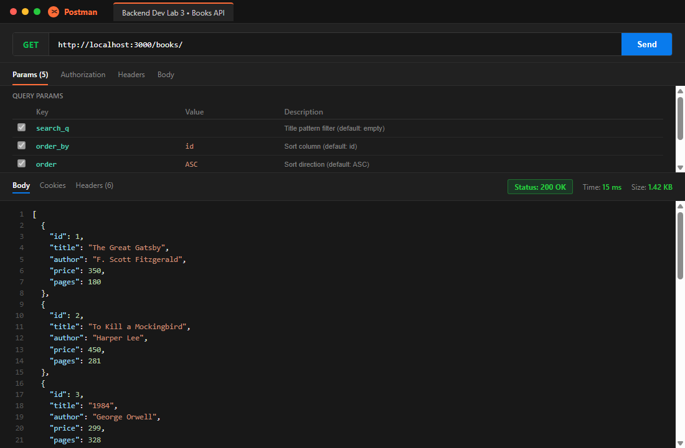

---

### 2. Search Query Parameter (`/books/?search_q=the`)
Filters books whose titles contain `"the"` (case-insensitive SQL `LIKE %the%`).
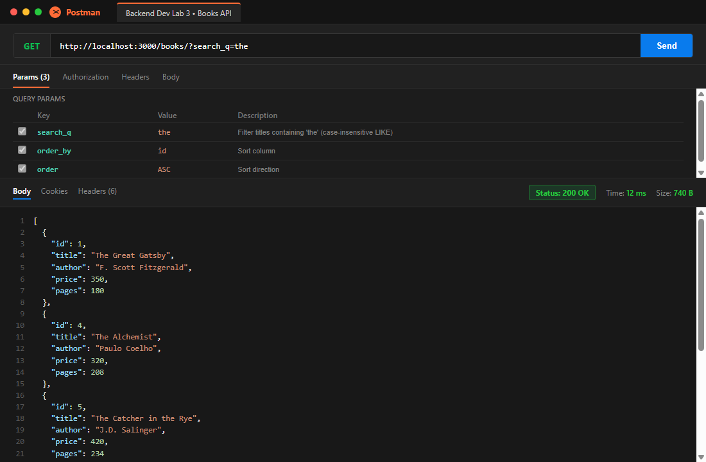

---

### 3. Price Range Filter (`/books/?min_price=300&max_price=600`)
Applies parameterized range filtering using `BETWEEN ? AND ?` for prices from 300 to 600 inclusive.
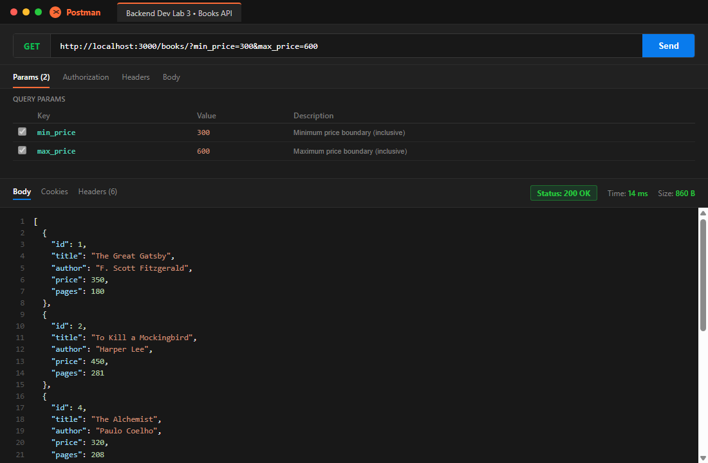

---

### 4. Sorting & Pagination (`/books/?order_by=price&order=DESC&limit=4`)
Demonstrates multi-parameter query processing: sorts by price in descending order, paginated to top 4 records.
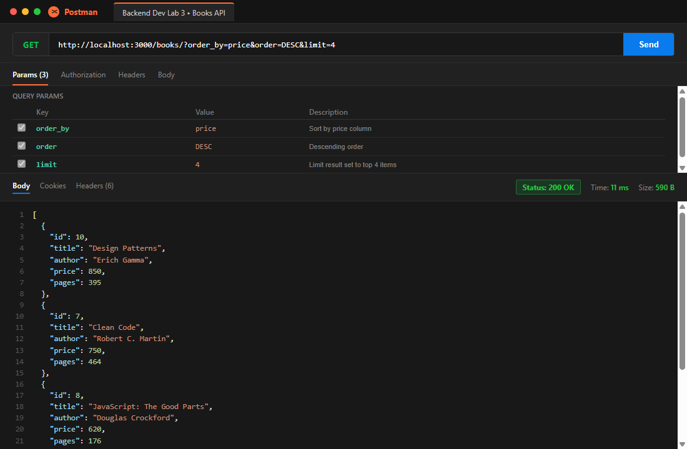

---

### 5. GET Single Book (`/books/1/`)
Fetches an existing book record by path parameter with `200 OK`.
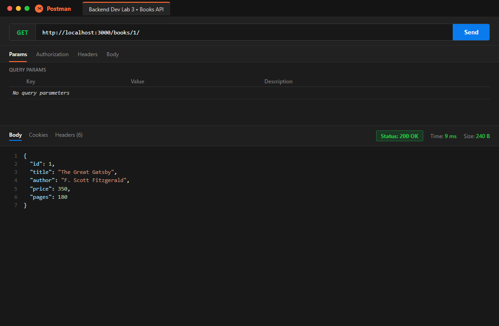

---

### 6. GET Book - 404 Error Case (`/books/999/`)
Handles requests for non-existent IDs with standardized error JSON and `404 Not Found`.
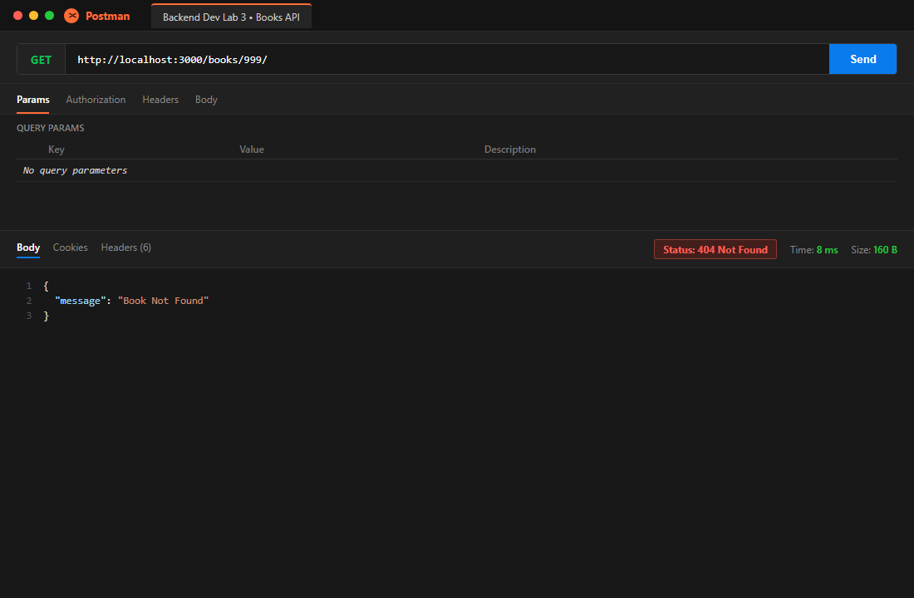

---

### 7. POST Add Book Success (`201 Created`)
Inserts a new book record into the SQLite database and returns the generated `bookId`.
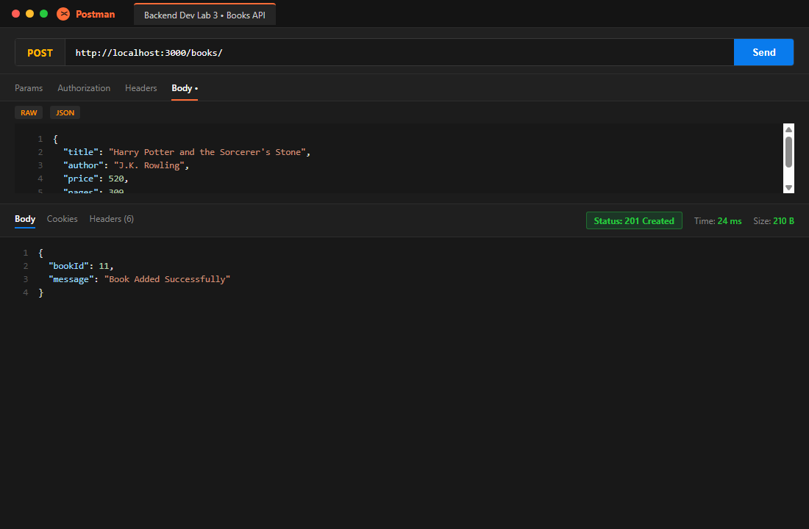

---

### 8. POST Missing Title Error (`400 Bad Request`)
Validates that `title` is non-empty and returns a descriptive error message with `400 Bad Request`.
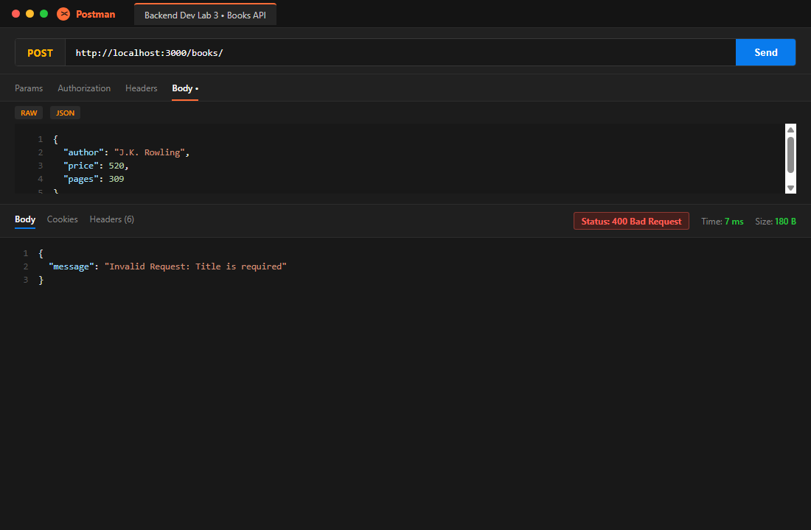

---

### 9. POST Non-Numeric Price Error (`400 Bad Request`)
Validates that `price` is a valid non-negative number and rejects invalid string input.
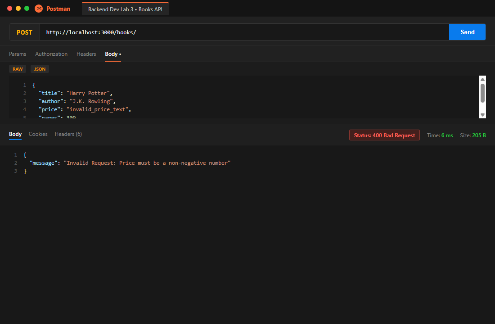

---

### 10. PUT Update Book Success (`200 OK`)
Updates an existing record's attributes and confirms success with `200 OK`.
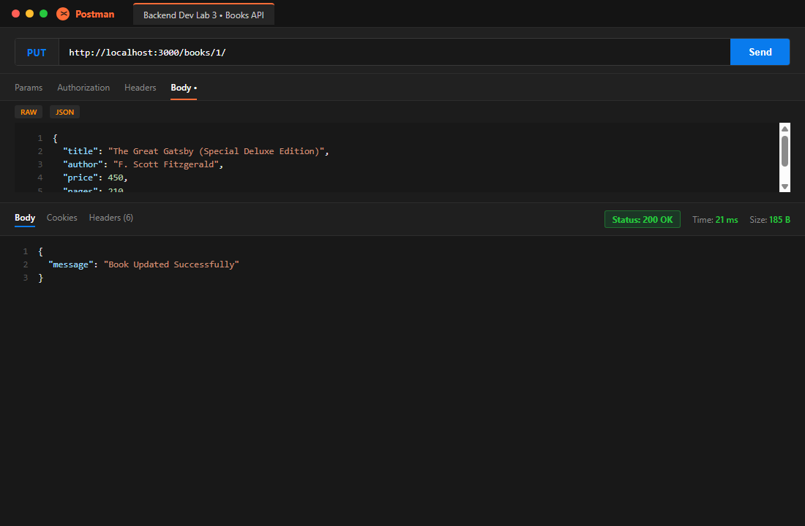

---

### 11. PUT Book - Not Found (`404 Not Found`)
Verifies book existence prior to updating; returns `404 Not Found` if ID does not exist.
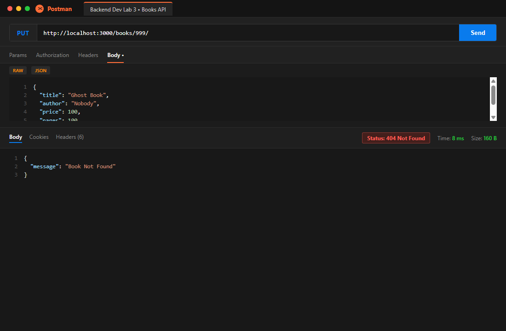

---

### 12. DELETE Book Success (`200 OK`)
Removes an existing book record from the database and returns `200 OK`.
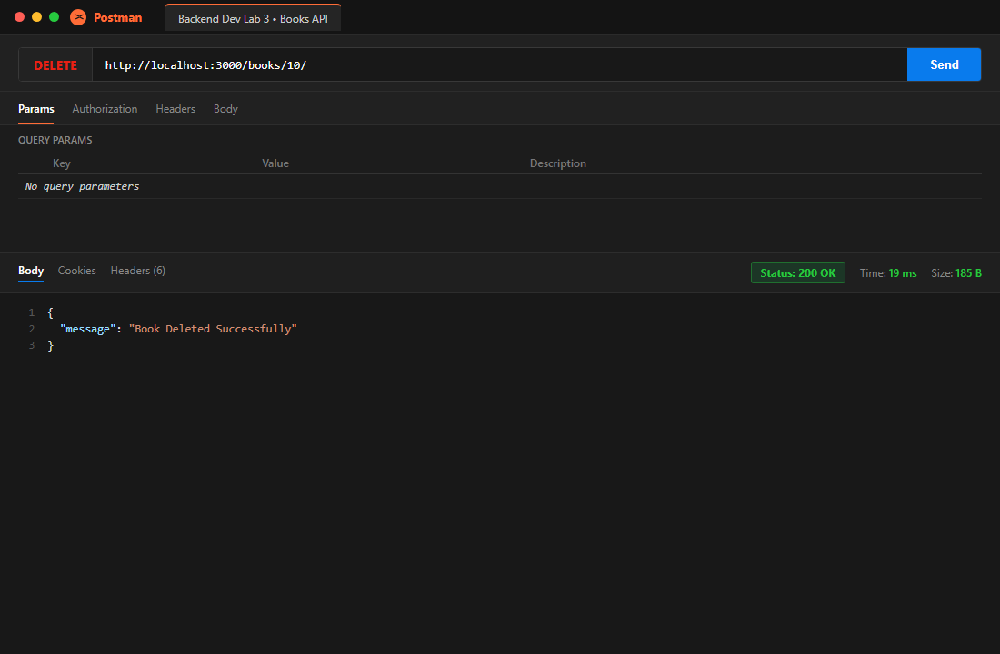

---

### 13. DELETE Book - Not Found (`404 Not Found`)
Verifies book existence prior to deletion; returns `404 Not Found` if ID does not exist.
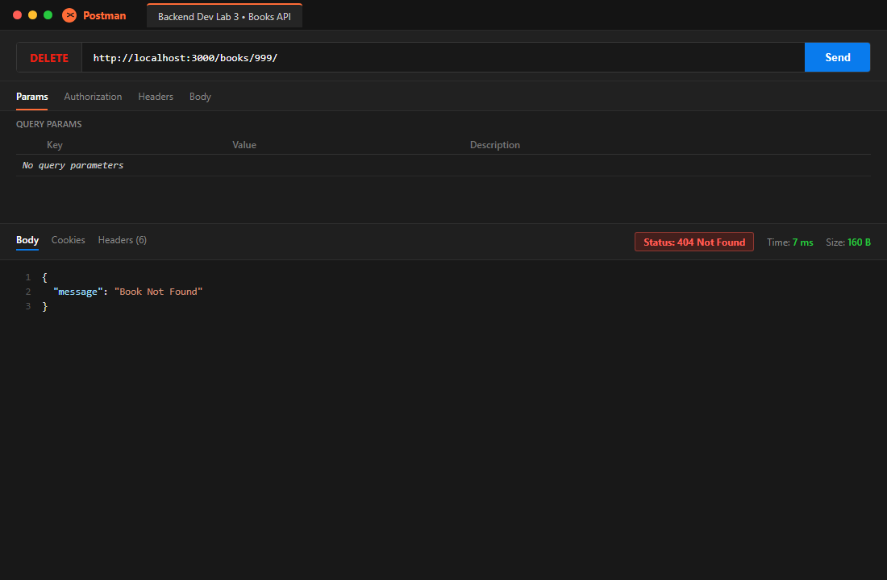

---

### 14. SQLite CLI Table View (Database Changes Before & After)
Direct verification inside SQLite CLI illustrating the initial seeded records, the newly inserted book (`id=11`), the updated record (`id=1`), and the removed record (`id=10`).
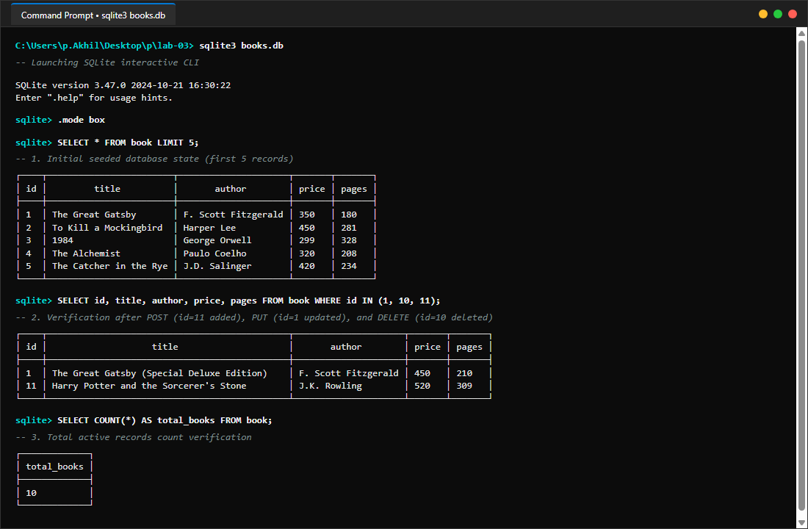

---

## Viva Questions & Answers

### Q1: What is the difference between a Query Parameter and a Path Parameter?
**Answer**:
- **Path Parameter**:
  - Embedded directly within the URL hierarchy (e.g., `/books/:bookId/` &rarr; `/books/42/`).
  - Used to identify a **specific resource** or document within a collection.
  - Path parameters are required parts of the endpoint path; omitting them changes the route matched by the server router.
- **Query Parameter**:
  - Appended at the end of the URL after a `?` delimiter in key-value pairs separated by `&` (e.g., `/books/?search_q=gatsby&order_by=price&limit=5`).
  - Used to **filter, sort, paginate, or modify representation** of the resource collection.
  - Query parameters are optional with sane default fallbacks, enabling flexible client customization without multiplying endpoints.

---

### Q2: What does "stateless" mean in the context of RESTful APIs?
**Answer**:
The **Statelessness** constraint is a foundational architectural principle of REST (Representational State Transfer) formulated by Roy Fielding:
- Every client request to the server must contain **all information necessary** to understand, authenticate, and process the request.
- The server does **not retain client session context** in memory between consecutive requests. Any session state is maintained entirely on the client side (e.g., in JSON Web Tokens or client application memory).
- **Key Architectural Benefits**:
  1. **Scalability**: Any server node in a distributed cluster can handle any request without synchronizing session memory across instances.
  2. **Reliability & Fault Tolerance**: Server crashes or restarts do not destroy user sessions.
  3. **Simplicity & Cacheability**: Independent requests simplify monitoring, logging, testing, and caching by intermediaries and CDNs.

---

### Q3: Which HTTP status code should be used for bad input versus a missing record (400 Bad Request vs 404 Not Found)?
**Answer**:
- **`400 Bad Request`**:
  - Used when the **client's request payload or syntax is defective**.
  - Examples: Missing required fields (`title` or `author`), malformed JSON syntax, invalid data types (such as sending a non-numeric string or negative integer for `price`), or out-of-range parameters.
  - The server understood the URI, but rejects processing because the input violates validation constraints.
- **`404 Not Found`**:
  - Used when the request syntax is syntactically valid and well-formed, but the **targeted resource identifier does not exist** on the server or in the database.
  - Examples: Accessing `/books/9999/`, running `PUT /books/9999/`, or issuing `DELETE /books/9999/` when no row with `id = 9999` exists in the `book` table.
  - Using 404 cleanly distinguishes missing resources from malformed client payloads.

---

## Debugging Notes & Common Error Resolutions

During backend API engineering with Node.js, Express, and SQLite, developers frequently face four classic failure modes:

### 1. Port Conflict (`EADDRINUSE: address already in use :::3000`)
- **Symptoms**:
  ```
  Error: listen EADDRINUSE: address already in use :::3000
      at Server.setupListenHandle [as _listen2] (node:net:1898:16)
  ```
- **Root Cause**:
  A previous Node.js process, development server, or background daemon was not terminated cleanly and remains bound to TCP port 3000.
- **Resolution**:
  - On Windows Command Prompt / PowerShell:
    ```powershell
    # Locate PID listening on port 3000
    netstat -ano | findstr :3000
    # Terminate the process forcefully
    taskkill /F /PID <PID>
    ```
  - In code: Implement environment fallback to allow dynamic port binding:
    ```javascript
    const PORT = process.env.PORT || 3000;
    app.listen(PORT, ...);
    ```

---

### 2. Wrong Import Path (`MODULE_NOT_FOUND`)
- **Symptoms**:
  ```
  Error: Cannot find module '../database/books'
  code: 'MODULE_NOT_FOUND'
  ```
- **Root Cause**:
  Relative directory paths misalign after folder restructuring, or file extensions and package names are misspelled. For SQLite databases, using relative string literals like `"books.db"` resolves relative to the process current working directory (`process.cwd()`) rather than the script directory, causing the database to be created in unexpected locations.
- **Resolution**:
  - Always use Node's built-in `path.join(__dirname, "books.db")` to guarantee absolute path resolution regardless of the terminal execution root:
    ```javascript
    const path = require("path");
    const dbPath = path.join(__dirname, "books.db");
    ```
  - Ensure all imported packages are listed in `package.json` under `dependencies` and installed via `npm install`.

---

### 3. Table Name Typo (`SQLITE_ERROR: no such table`)
- **Symptoms**:
  ```
  SQLITE_ERROR: no such table: books
  ```
- **Root Cause**:
  A discrepancy between the SQL DDL schema creation statement (e.g., `CREATE TABLE book ...` in singular form) and the query written in route handlers (e.g., `SELECT * FROM books ...` in plural form).
- **Resolution**:
  - Standardize schema naming conventions across the entire codebase. In this lab, the table is explicitly named `book`.
  - Audit all queries in `app.js` (`SELECT`, `INSERT`, `UPDATE`, `DELETE`) to verify that the table identifier strictly matches `book`:
    ```sql
    SELECT * FROM book WHERE title LIKE ?;
    ```
  - Verify table existence directly via SQLite CLI using `.tables` or `SELECT name FROM sqlite_master WHERE type='table';`.

---

### 4. Missing `await` on Asynchronous Database Calls
- **Symptoms**:
  The route returns an empty response, an unresolved Promise `{}` in JSON, or execution proceeds before the query finishes, triggering subtle race conditions.
  ```json
  {}
  ```
- **Root Cause**:
  Driver calls like `db.all()`, `db.get()`, and `db.run()` return ECMAScript Promises. Forgetting the `await` keyword causes Express to attempt serializing the unresolved Promise object immediately.
- **Resolution**:
  - Ensure every asynchronous database call is preceded by `await`:
    ```javascript
    // Incorrect:
    const book = db.get(getBookQuery, [bookId]);
    // Correct:
    const book = await db.get(getBookQuery, [bookId]);
    ```
  - Mark every route callback with `async (request, response) => { ... }`.
  - Wrap database operations in `try...catch` blocks to catch and route Promise rejections to error handlers with `500 Internal Server Error`.
